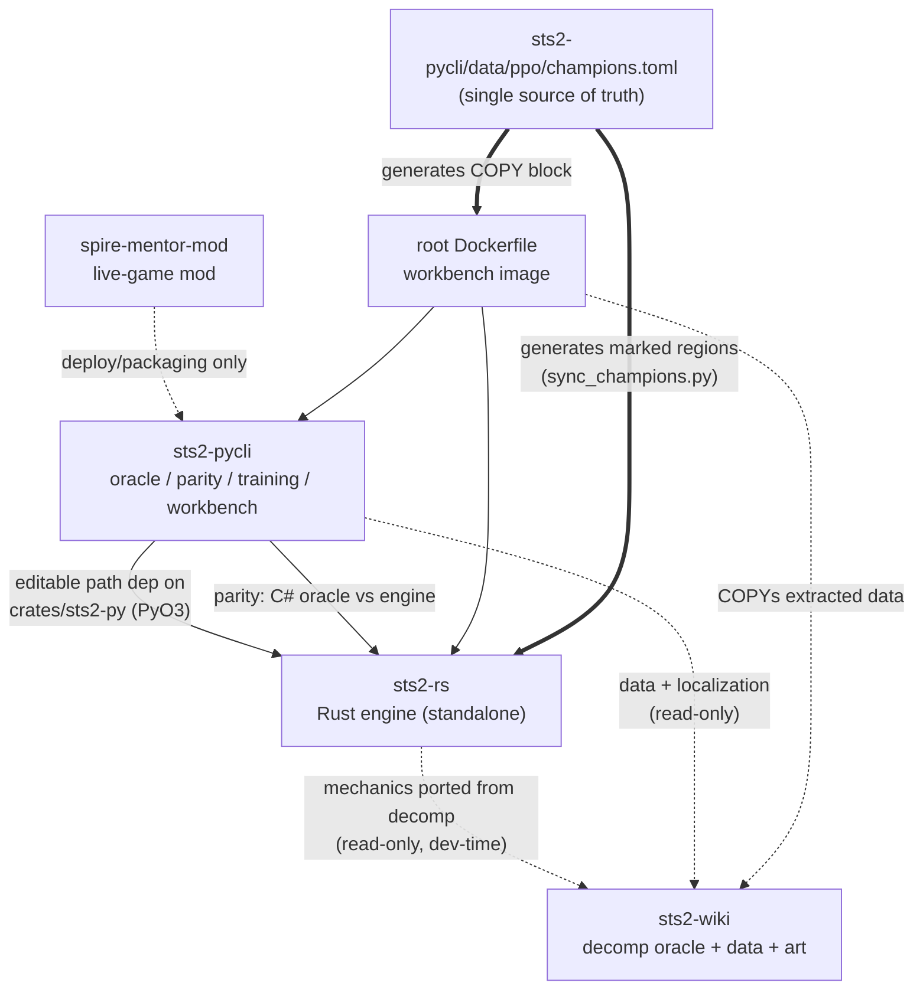

# Architecture

How the four subprojects and the root infrastructure fit together. For what
each piece *may ship publicly*, see [PROVENANCE.md](PROVENANCE.md) and
[docs/open-source-plan.md](docs/open-source-plan.md).

## Components

### sts2-wiki — the upstream leaf (mechanics oracle)

Decompiles a personally-owned copy of the game (`just decompile`), extracts
data and art (`just extract`), and generates a static Astro wiki.
`decompiled/v0.107.1/` (~3,400 C# files; ~6,800 across the two retained builds) is the **authoritative source of
truth for game behavior** — every "is this behavior correct?" question in the
other subprojects is answered by grepping it. Depends on **no** sibling;
everything else consumes it read-only.

### sts2-rs — the Rust engine

A 9-crate workspace, deliberately standalone-buildable (builds and tests with
no siblings on disk; the few sibling touches are env-overridable or
`exists()`-guarded):

| Crate | Role |
|---|---|
| `sts2-core` | Combat engine: state, events, powers, the fixed-point rules kernel |
| `sts2-content` | Cards / monsters / relics / potions ported from the decomp |
| `sts2-mcts` | Monte-Carlo tree search over combat |
| `sts2-runai` | Whole-run AI: PPO run-policy inference (ONNX), value/ranker nets |
| `sts2-cli` | Binaries: replay, sweeps, feature dumps |
| `sts2-wire` | Serialization / wire formats |
| `sts2-py` | PyO3 bindings — the bridge into sts2-pycli |
| `sts2-srchash` | Source-hashing support |
| `sts2-bench` | Benchmarks |

Plus `fuzz/`, `xtask/`, frozen parity fixtures under `tests/parity/` (the
Python recorder that produced them is retired — see
`sts2-rs/PYTHON_SIM_PIN.md`), and seed panels under `data/`.

### sts2-pycli — the integration hub

The most entangled node, by design. Concerns:

- **C# headless oracle** (`src/Sts2Headless/` + clean-room `src/GodotStubs/`)
  — runs vendored IL-patched game DLLs (`lib/`, git-LFS) without Godot, so
  the *real game code* can be scripted deterministically.
- **Parity harness** — drives the C# oracle and the Rust engine in lockstep
  over the same seeds/runs and diffs state (`python/parity_audit.py`,
  `python/act23_state_parity.py`, …). LFS caches under `data/parity-cache/`
  and `data/run-parity-cache/` replay the C# side at Rust speed.
- **PPO training** — trains run-policy champions against the Rust engine via
  the `sts2_rs` PyO3 module; promotion flows through `champions.toml` (below).
- **Workbench** — web app (Python-backed server, or browser-only via the wasm build; the private repo also carries a Docker deploy image).
- **Bridge client / advisor** — talks to spire-mentor-mod's TCP protocol; the
  advisor ships as a frozen exe (`packaging/SimAdvisor.spec`).

Hard build edge: `pyproject.toml` declares an **editable path dependency** on
`../sts2-rs/crates/sts2-py` — the one edge that makes sts2-pycli
non-standalone today (decision D4 in the open-source plan).

### spire-mentor-mod — the live-game mod

C# mod ("Spire Mentor") loaded into the running game, exposing state and
commands over TCP (`PROTOCOL.md` is the contract). Compiles with zero sibling
files; couples to sts2-pycli only at dev-deploy/packaging time.

### Root infrastructure

- `justfile` — umbrella tasks dispatching into the subprojects.
- `Dockerfile` (private repo only) — workbench deploy image; its build context spans sts2-rs,
  sts2-pycli, and sts2-wiki data, and it contains a generated champions COPY
  block (see below).
- `release/` — the manifest + exporter that produce the public snapshot repo.

## Dependency diagram

Solid arrows are build/runtime dependencies; dotted are dev-time or
deploy-time only; thick arrows are the code-generation inversion.

## Data flow

- **Decomp → engine:** game mechanics are ported by hand from
  `sts2-wiki/decompiled/v0.107.1/` into `sts2-rs/crates/sts2-content` (and
  audited back against it — see the faithfulness-audit skills in
  `sts2-rs/.claude/skills/`).
- **Training loop:** sts2-pycli trains PPO policies against the Rust engine
  (via `sts2_rs` bindings), writes checkpoints/ONNX under
  `sts2-pycli/data/ppo/`, and training artifacts land in
  `../sts2-rs/data/runai/` for the Rust side to serve.
- **Champion serving:** at runtime `sts2-runai` resolves champion `.onnx`
  files from the sibling sts2-pycli tree when present (env-overridable);
  the container and the advisor exe carry their own copies.
- **Parity data:** the harness replays a corpus of real player runs
  (`sts2-rs/data/run-corpus/`, LFS) through both engines; C#-side traces are
  cached in `sts2-pycli/data/*parity-cache/`.

## The champions.toml generation flow

`sts2-pycli/data/ppo/champions.toml` is the **single source of truth** for
the deployed PPO run-policy champions. Every serving lane reads it — the
Python loader, both workbench inference backends, the advisor spec — except
two that *cannot* read it at runtime:

1. `sts2-rs/crates/sts2-runai/src/ppo/net.rs` — a Rust worktree has no
   sibling sts2-pycli;
2. the root `Dockerfile` — `COPY` is Dockerfile syntax.

Those two carry `GENERATED FROM sts2-pycli/data/ppo/champions.toml — DO NOT
EDIT` regions, rewritten by `sts2-pycli/scripts/sync_champions.py` (`just
sync-champions`) and byte-checked by `just check-champions` (which runs
inside `just check` / `just ci`). Promotion is one command from sts2-pycli:
`just promote-champion <character> <onnx>`.

This exists because the previous design (four hand-kept lists, with the
Python member *globbing* for the newest net present) shipped a container
silently serving a retired net (PR #339). Exact filenames + a byte-check gate
make a stale net inert and a missing champion a loud error. **Never hand-edit
inside the markers.**

## The parity stack

Two independent implementations of the same game, diffed continuously:

- **Oracle:** the game's own code — `sts2-pycli/src/Sts2Headless/` hosts the
  vendored IL-patched `sts2.dll` with Godot stubbed out, so real game logic
  runs headless and deterministic.
- **Subject:** the Rust engine.

The Python harness drives both from the same seeds and player-run corpus,
compares full state at each decision point, and classifies residuals
(REAL_BUG vs ORACLE_ARTIFACT). Historical layer: `sts2-rs/tests/parity/`
holds frozen fixtures recorded from a now-retired Python simulator
(`sts2-rs/PYTHON_SIM_PIN.md` is the provenance record for the
`Ported from sts2-rl-agent@…` headers).
