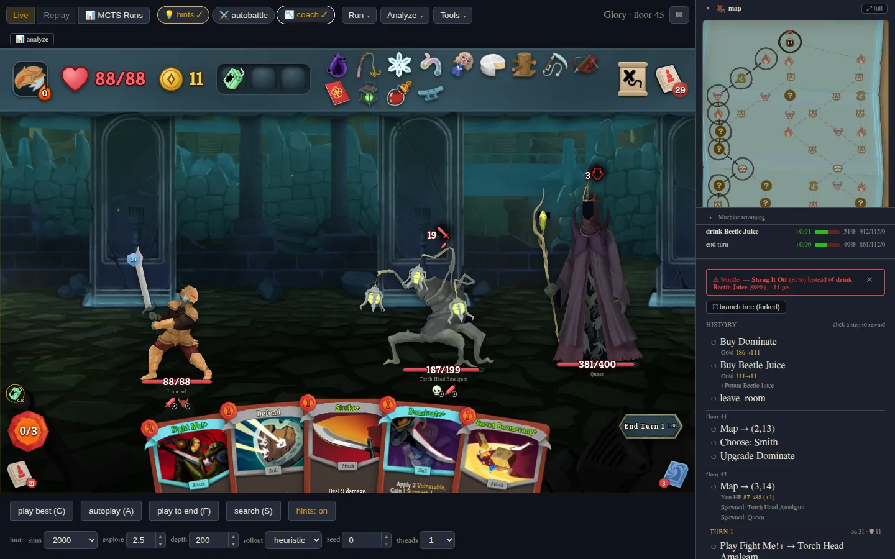
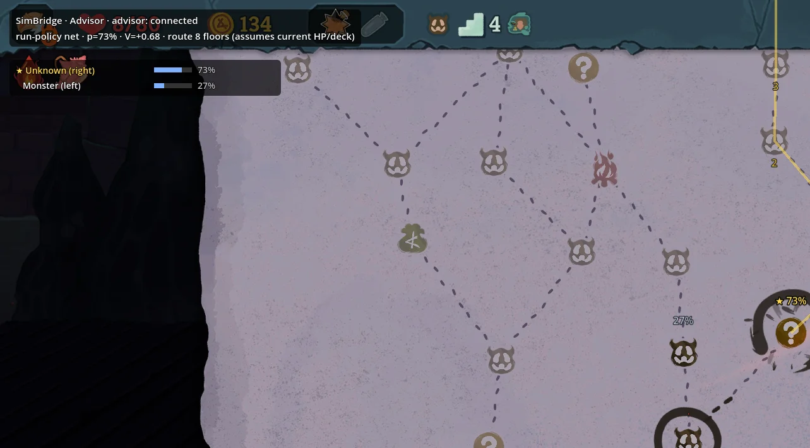

# spire-mentor

[](https://github.com/tfriedel/spire-mentor/actions/workflows/ci.yml)
[](https://tfriedel.github.io/spire-mentor/)
[](https://steamcommunity.com/sharedfiles/filedetails/?id=3821016481)

**A Rust simulator of Slay the Spire 2's combat and run rules, plus a strong AI trained on it.  
It's an analysis and training tool for people who own the game: replay positions in the browser, see how the AI would play them, or let it coach you.  
You can even let the AI play the fights, so you can practise the run-level decisions.**

> **You need your own copy of Slay the Spire 2** (Steam). This project is not
> affiliated with Mega Crit. Art and sound are extracted locally from your
> install and are never distributed; the repository contains no art, audio or
> game code. See [what's included](#whats-included-and-what-isnt).


<sub>The browser workbench in the act-3 boss fight: the search marks the best
card with its win chance, and the machine-reasoning panel ranks every legal
move.</sub>

## Highlights

### Simulation

- complete Rust port of the combat and run rules for **all characters**, cards, relics, potions and enemies of the current stable build v0.107.1  
- optimized for [speed](https://tfriedel.github.io/spire-mentor/benchmarks.html), but with no compromises on accuracy: \~1,500× faster than running the game's own combat logic headless on one core (\~60k combats/s), \~2,400× using the whole machine. This was also the main reason to port the rules to Rust, because the training time is bottlenecked by the simulation.  
- parity tests and fuzzing against the game's own code after every action. After the initial implementation I found there were lots of little differences between the simulation and the real game, so I invested a lot of effort into extensive parity testing. Ironclad is currently at 100% parity, the other characters between 99.4% and 99.8%.  
- Python bindings so you can run combats, full runs or the training stack from Python

### AI

- MCTS-based combat  
- PPO / reinforcement-learning-based run-level AI, trained over many weeks, with the best win rates of any STS2 AI I'm aware of (e.g. Ironclad champion `cardmods_it850`: 30% A10 in the simulator at the advisor's 4,000 sims per decision, 16,000 in boss fights; its predecessor won 96% at A0 at 8,000)  
- **non-clairvoyant** / using chance nodes, i.e. it doesn’t cheat by exploiting the RNG or using information like which card it’s about to draw

### UI / workbench

- the workbench runs in your browser (WASM). With art and sound imported from your own install (one command), it looks like the real game. Neither is included in this git repository.  
- revert to any step and branch off to play a situation in multiple different ways  
- use AI to coach you  
- let the AI play the fights so you can practise the macro decisions  
- analyze your game after you've finished to find the biggest blunders  
- copy a state from the real game into the workbench to analyze it  
- explore the MCTS search tree  
- synergy catalog
- a game mod with many of these features inside the real game (see [below](#spire-mentor-mod))

## Numbers

| | |
|---|---|
| Engine coverage | 5 characters · 580 card ids · 297 relics · 63 potions · 272 powers · 121 monsters · 69 events · 4 act models |
| Parity vs the game's C# | lockstep after every action, a 5,000-seed fuzz tier · last full sweeps: Ironclad 6,104/6,104 fuzzed fights clean (June 2026), the other characters 99.4–99.8% (July 2026) · whole runs 1,232/1,250 clean (July 2026) |
| Throughput | one core: ~59k random-play fights/s · ~1.3M engine actions/s · whole machine (24 cores / 48 threads): ~1.4M fights/s · ~31M actions/s · vs the shipped game run headless ~2,430× whole machine |
| MCTS | search: 1,000 sims ≈ 14 ms native, one thread  |
| Training | a typical PPO iteration (Ironclad, 960 games, 46 workers, one RTX 3090) ≈ 208 s, 150 iterations ≈ 9 h |
| Code | ~360k lines of Rust · ~116k Python · ~56k TypeScript · 7,000+ Rust tests, 3,000+ Python, 1,400+ web |

More performance benchmarks: [benchmarks page](https://tfriedel.github.io/spire-mentor/benchmarks.html);
method and commands:
[`sts2-rs/docs/perf/2026-10-14-benchmarks.md`](sts2-rs/docs/perf/2026-10-14-benchmarks.md).

**Win rates of the current champions** (8,000 sims per decision,
measured October 2026; 200 runs per cell at A0–A8, 500 at A9–A10;
except the first Ironclad row, see below):

| Character | A0 | A4 | A8 | A9 | A10 | Mean A0–A10 | Promotion gate (vs previous champion) |
|---|---|---|---|---|---|---|---|
| Ironclad `cardmods_it850` (4,000/16,000 sims, 400 runs) | – | – | – | 56.5%* | 30.0% | – | A10: +6.4 pp, p = 9e-5 |
| Ironclad, previous champion `a10_it700` | 96.0% | 95.0% | 84.5% | 56.4% | 27.2% | **83.6%** | pooled +1.6 pp, p = 0.11 (missed); promoted on A10: +6.9 pp, p = 9e-7 |
| Defect | 93.0% | 90.5% | 70.0% | 39.2% | 22.0% | **76.1%** | +5.5 pp, p = 2e-6 |
| Silent | 78.5% | 67.5% | 55.5% | 20.0% | 9.0% | **59.9%** | +5.6 pp, p = 7e-7, all 11 levels up |
| Regent | 67.5% | 66.0% | 43.5% | 15.6% | 6.2% | **53.8%** | +4.6 pp, p = 1e-4 |
| Necrobinder | 66.5% | 62.5% | 44.5% | 13.8% | 5.6% | **51.7%** | +6.8 pp, p = 6e-10, all 11 levels up |

The current Ironclad champion, `cardmods_it850` (promoted 27 October 2026),
has so far been measured only at A10, on a different budget from the rest of
the table: 400 runs at the advisor's 4,000 sims per decision (16,000 in boss
fights), on a separate seed panel. It won 30.0% (95% interval 25.7–34.7%).
\*The A9 cell is an estimate from those same A10 runs, not an A9 sweep: A10
is A9 plus a second final boss, so a run that beats the first one has won the
A9 run's last fight; 56.5% did (51.6–61.3%). On the same seeds and budget the
previous champion won 26.75% at A10 (52.25% A9 estimate). A0–A8 have not been
re-run for the new net; the previous champion's row, at 8,000 sims, is kept
below it. Record:
[`docs/experiments/2026-10-27-ironclad-a10-cardmods.md`](docs/experiments/2026-10-27-ironclad-a10-cardmods.md).

Win rates for every ascension level are in the
[docs](https://tfriedel.github.io/spire-mentor/#ai). The table mixes dates
and generations of combat search: the previous Ironclad row was re-measured on 26
October 2026 with that champion (`a10_it700`) and the combat search the
run agent has shipped for Ironclad since 26 October (a gated layer of search
settings plus a move prior in elite and boss fights, on top of the learned
playout net it has used since 18 October), on that day's engine; the other four
rows are from the 11–13 October 2026 sweep, on the engine of that time. Those
four keep the same champions, but their combat search has used a learned
playout net of its own since 21 October, and their rows have not been re-run
since. The 8,000-sim rows share seeds and protocol; comparisons between the
Ironclad rows and the others are descriptive. Write-ups:
[`docs/experiments/2026-10-26-ironclad-release-winrates.md`](docs/experiments/2026-10-26-ironclad-release-winrates.md)
and [`docs/experiments/2026-10-11-release-winrates.md`](docs/experiments/2026-10-11-release-winrates.md).
The last column is each champion's own promotion gate, at the gates' cheaper
1,000/4,000-sim budget, from its provenance file in `sts2-pycli/data/ppo/`.
Ironclad's last two champions were gated on A10 alone.
`cardmods_it850` passed a pre-registered A10 gate, 21.7% → 28.1% on 1,000
paired seeds
([`ppo_fullrun_ironclad_cardmods_it850.provenance.md`](sts2-pycli/data/ppo/ppo_fullrun_ironclad_cardmods_it850.provenance.md));
`a10_it700` missed the pooled significance bar and was promoted on its A10
result
([`ppo_fullrun_ironclad_a10_it700.provenance.md`](sts2-pycli/data/ppo/ppo_fullrun_ironclad_a10_it700.provenance.md)).

## The browser workbench



I started out with a CLI-based interface to the STS2 simulator, but this has now turned
into a full-blown React front end over the Rust engine compiled to WebAssembly, with animations and sound.
The graphics and sounds come from your own copy of the game: `just import-game` extracts them locally.

Some things you can do:

- **Play** any character, seed and ascension. You can either play manually or let the AI take over for a single action,
turn or even a full run.
- **Rewind and branch** any decision; like save-scumming, it lets you explore many "what-ifs".
- **Ask the AI** for a combat hint, open the MCTS search tree, rank the
  choices on a card reward, shop or event, or let it play the best line.
- **Coach**: after each of your moves, the AI reveals how it would have played.
  If you make a particularly bad move, it will tell you.
- **Autobattle**: if you want to focus on learning deck building / work on your run-level decisions (paths, cards, shops, events),
  you can let the AI play the fights for you in this mode.
- **Review**: the AI constantly estimates your chance of winning. It can go through your whole run and highlight any dips. This is similar to what some chess engines offer.
- **SimLab**: set up any single fight (character, deck, HP, relics, potions, enemies, ascension) and see what the search thinks of
  every move, or replay it many times for the spread of outcomes and
  seed-paired strategy studies. This is the tool for questions like
  "is it better to remove a Strike or a Defend?".
- **Lab tools**: replay viewer, MCTS-runs browser, deck analysis, and
  *state import*, where you paste a position copied from the live game and
  analyze it here.

### Workbench quickstart

You need `rustup`, `just` 1.38+, `uv`, Node 20+ and the `wasm-bindgen` CLI
in the version the crate uses
(`cargo install wasm-bindgen-cli --version 0.2.120 --locked`). The repo pins
Rust 1.99.1 and the `wasm32-unknown-unknown` target, so `rustup` fetches those
by itself, and the first build runs `npm install` for you. On Windows,
`.\install-windows-deps.ps1` installs everything except `rustup`, `uv`, git
and the VS Build Tools (see [Windows](#windows)).

```sh
just import-game          # optional: real art and sound from your copy of the game
just workbench-local      # build + serve on http://127.0.0.1:4173
```

If you skip `import-game`, the workbench still runs with the real card text,
but with placeholder art and no sound. To import the art and sound you also
need `ilspycmd`, `cwebp` and `ffmpeg`. See
[Building from source](#building-from-source) and
[docs/bring-your-own-game.md](docs/bring-your-own-game.md).

## Spire Mentor mod



A lighter version of the workbench that runs inside the real game: the AI can advise you or make the decisions for you.

**To play with it, subscribe on the [Steam Workshop](https://steamcommunity.com/sharedfiles/filedetails/?id=3821016481)**
(Windows only; Steam installs BaseLib along with it). The workbench is
bundled with the mod and follows your run in the browser.

- **Advisor mode**: you play, and the mod shows the ranked moves with their
  MCTS statistics, scores for card rewards and shop items, the recommended
  map route and your estimated chance of winning.
- **AI turns**: `F6` lets the AI make one decision, `F7` lets it keep playing
  until you stop it. Autopilot plays whole runs on its own.
- **Rewind**: the mod saves a snapshot (including the RNG state) every time
  you enter a room. You can undo a combat turn (`Ctrl+Z`), restart a room or
  go back to any earlier room, even after a fight is over, and the game
  continues exactly as it would have.
- **Workbench link**: open the current game state in the workbench, browse
  the game's history there and rewind the real game from the browser.
- There's also a toolbar, an in-game help panel (`F1`), an action log, speed
  controls and a settings page.

How to build and install it, and the protocol it uses to talk to the AI:
[`spire-mentor-mod/README.md`](spire-mentor-mod/README.md),
[`spire-mentor-mod/PROTOCOL.md`](spire-mentor-mod/PROTOCOL.md).

## Repository layout

| Subproject | Language | What it is |
|---|---|---|
| [`sts2-rs/`](sts2-rs/) | Rust | The engine, MCTS, the run AI (ONNX policy inference), a CLI, the PyO3 bindings and the engine part of the workbench (WASM). Builds and tests on its own. |
| [`sts2-pycli/`](sts2-pycli/) | Python + C# + TS | Most of the rest: the headless C# harness that runs the real game code (from your copy) for parity testing, the parity tests, PPO training, the workbench web app, the real-game advisor, and an MCP server so an LLM can play. |
| [`spire-mentor-mod/`](spire-mentor-mod/) | C# | The Spire Mentor mod. |
| [`sts2-wiki/`](sts2-wiki/) | Python / Astro | Extraction tools: decompiles your copy of the game, extracts data, art and sound, and can generate a static wiki. |
| `scripts/import_game.py` | Python | What `just import-game` runs. Extracts everything the repo needs from your game install. |

There's more in [ARCHITECTURE.md](ARCHITECTURE.md) and in the full
documentation with screenshots at
**[tfriedel.github.io/spire-mentor](https://tfriedel.github.io/spire-mentor/)**
(source in [`docs/site/`](docs/site/)).

## What's included and what isn't

> Slay the Spire 2 is © Mega Crit. This project is not affiliated with or
> endorsed by them. The repository contains the game's **text**, so the engine, the AI and the workbench work out of the box. It
> contains **no art, audio, game assemblies or decompiled code**. The tooling
> extracts those from **your own copy of the game**
> ([docs/bring-your-own-game.md](docs/bring-your-own-game.md)) into paths that
> git ignores. See [NOTICE](NOTICE) and [PROVENANCE.md](PROVENANCE.md).

## Building from source

There are three levels of setup, depending on what you want to work on. More
on the prerequisites in
[docs/bring-your-own-game.md](docs/bring-your-own-game.md).

**Engine only (no game needed).** Rust 1.99.1 (pinned by
`sts2-rs/rust-toolchain.toml`), `cargo-nextest` and `just` 1.38+. `sccache`
is optional; to use it, `export RUSTC_WRAPPER=sccache`.

```sh
just rs-check      # cargo check --workspace --all-targets
just rs-test       # cargo nextest run --workspace  (never bare `cargo test`)
just rs-doc-test   # cargo test --workspace --doc   (nextest cannot run doctests)
```

**The C# parity harness.** You also need the game, the .NET 9 SDK and `uv`.

```sh
just import-game /path/to/Slay\ the\ Spire\ 2 --tier oracle
cd sts2-pycli && uv sync --dev && just build-cs && uv run pytest tests
```

**The workbench with real art and sound (and the decompiled source).**
Everything from the [workbench quickstart](#workbench-quickstart), plus
`ilspycmd` 9.1 (`dotnet tool install -g ilspycmd --version 9.1.0.7988`),
`cwebp` (libwebp) and `ffmpeg`. On Linux the sound also needs the FMOD SDK
(`FMOD_SDK_ROOT`, see [docs/bring-your-own-game.md](docs/bring-your-own-game.md));
on Windows it uses the FMOD runtime that ships with the game.

```sh
just import-game          # finds the game through Steam; art, data and sound
just workbench-local      # build + serve on http://127.0.0.1:4173
```

`workbench-local` builds `sts2-pycli/web/dist` and serves it on this machine
only. The engine runs in the browser as WASM, so there's no backend.
`just workbench-server` is the alternative with a Python backend, on port 8077.

**Please run the workbench locally and don't host it publicly.** With the
real art, the build contains the game's images and sound, which you
extracted from your copy for your own use. The servers only listen on
`127.0.0.1` by default. Set `STS2_HOST` (Python servers) or `STS2_WEB_HOST`
(Vite) to make them reachable from your LAN.

**The mod.** You need Windows, the game at v0.107.1, the .NET 9 SDK and
[BaseLib](https://github.com/Alchyr/BaseLib-StS2) v3.4.1 in
`<game>/mods/BaseLib/` (`install-windows-deps.ps1` installs both).
`cd spire-mentor-mod && dotnet build` builds the mod and copies it into the
game's `mods/` folder. The in-game advisor also needs `cd sts2-pycli && uv sync`
once. Details in [`spire-mentor-mod/README.md`](spire-mentor-mod/README.md).

## Windows

Everything above works from **PowerShell**; on Windows the root `justfile`
runs its recipes in PowerShell. From a fresh clone:

```powershell
.\install-windows-deps.ps1                  # the toolchain (winget / cargo / dotnet), safe to re-run
# open a new terminal so the tools are on PATH
just import-game                            # finds the game through Steam
just workbench-local                        # http://127.0.0.1:4173
cd spire-mentor-mod; dotnet build           # the mod (install BaseLib first, see spire-mentor-mod\README.md)
```

The script installs everything except `rustup`, `uv`, git and the VS Build
Tools (needed as the Rust linker). It checks that those are there.
[BUILDING-WINDOWS.md](BUILDING-WINDOWS.md) has the details. The justfiles in
the subprojects (`sts2-rs/`, `sts2-pycli/`, `sts2-wiki/`) use bash, so run
those from Git Bash.

## Testing

- Rust: `cargo nextest run --workspace` **and** `cargo test --workspace --doc`
  from `sts2-rs/`. Don't use plain `cargo test`: it runs all tests in one
  process, which causes random false failures here. Tests that need the game
  data are skipped if it's missing.
- Python: `uv run pytest tests` from `sts2-pycli/`. Tests that need the C#
  harness have the `oracle` marker and are skipped without `lib/sts2.dll`.
  CI runs `-m "not oracle"`, the subset that works without the game.
- Web: `npm test` from `sts2-pycli/web/` (vitest). Tests that need the
  extracted art or audio are skipped without them.

## Contributing

See [CONTRIBUTING.md](CONTRIBUTING.md). It also explains how this repository
is synced from my private development repo.

## Credits

- `sts2-pycli` began as a fork of [wuhao21/sts2-cli](https://github.com/wuhao21/sts2-cli)
  by Hao Wu (MIT).
- Spire Mentor started as a port of zhiyue's STS2BridgeMod from
  [zhiyue/sts2-rl-agent](https://github.com/zhiyue/sts2-rl-agent).
- The mod's settings page uses Alchyr's
  [BaseLib](https://github.com/Alchyr/BaseLib-StS2).

## License

MIT, see [LICENSE](LICENSE). `sts2-rs/`, `sts2-pycli/`, `spire-mentor-mod/` and
`sts2-wiki/` each have their own MIT license file. The license only covers the
original work in this repo; nothing from the game is licensed or included.
